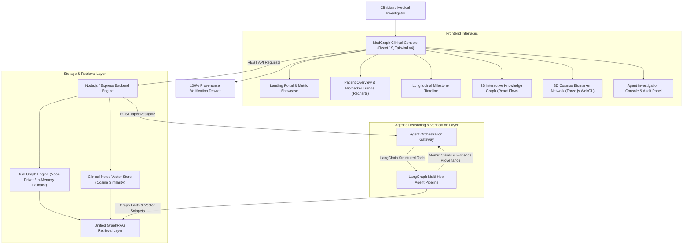

# MedGraph: Longitudinal Clinical Knowledge Graph & Agentic Investigation Platform

> **Longitudinal Clinical Knowledge Graphs • Multi-Admission Delta Engine • GraphRAG • 100% Provenance Verification**

[](https://www.typescriptlang.org/)
[](https://react.dev/)
[](https://tailwindcss.com/)
[](https://nodejs.org/)
[](https://neo4j.com/)
[](https://langchain-ai.github.io/langgraph/)
[](https://threejs.org/)
[](LICENSE)

---

## Executive Summary

Modern electronic health records (EHRs) are notoriously fragmented. When a complex patient with multiple chronic conditions is admitted to the hospital, clinicians must piece together fragmented discharge summaries, specialist consultation notes, lab trajectories, and changing prescription regimens spanning months or years.

Traditional LLM summarization systems fail critically in clinical environments because they:
1. **Hallucinate clinical timelines** and confuse the temporal order of events.
2. **Conflate correlation with causation** (e.g., claiming a drug caused a lab drop without documented rationale).
3. **Miss direct clinical contradictions** between triage notes, nursing charts, and attending physician documentation.
4. **Lack deterministic provenance**, making it impossible for clinicians to verify where a claim originated.

**MedGraph** resolves these fundamental challenges by combining a **bi-temporal clinical knowledge graph** (Neo4j with an in-memory fallback engine) with **patient-scoped semantic vector retrieval** and an **agentic LangGraph reasoning pipeline**. MedGraph automatically identifies multi-admission deltas, detects documented clinical contradictions, flags missing documentation, and surfaces atomic, verified evidence citations for every clinical claim.

---

## System Architecture



---

## Core Capabilities

### 1. Longitudinal Multi-Admission Delta Engine
- **Automated Regimen Comparison**: Compares any two hospital admissions to compute medications introduced, discontinued, or dosage-adjusted.
- **Biomarker Trajectory Tracking**: Detects critical lab shifts across admissions (e.g., Creatinine doubling, Potassium spikes, INR volatility).
- **Documented Rationale Extraction**: Automatically maps clinical explanations from doctor notes to structural medication modifications.

### 2. Dual-Engine Graph Architecture
- **Production Neo4j Engine**: Enterprise-grade graph database connectivity utilizing parameterized Cypher queries, indexed unique constraints (`Patient.id`, `Admission.id`), and relation traversals.
- **High-Fidelity In-Memory Fallback**: Zero-dependency built-in graph engine providing identical Cypher-equivalent traversal, filtering, and comparative operations, ensuring complete offline and Docker-less operation out of the box.

### 3. Patient-Scoped Vector Retrieval (GraphRAG)
- **Zero Cross-Patient Leakage**: Enforces strict mathematical and logical isolation boundaries by partitioning all vector collections by `patient_id`.
- **Hybrid Fusion Search**: Merges deterministic graph traversal facts (admissions, conditions, medications, labs) with semantic cosine-similarity search across clinical notes and discharge summaries.

### 4. Interactive Visual Explorers
- **Modern Medical Blue UI**: Clean, high-contrast clinical interface optimized for rapid data comprehension in both light and dark environments.
- **2D Knowledge Graph (React Flow)**: Interactive canvas with royal blue directional connections, category filtering (Admissions, Medications, Conditions, Labs), zoom/pan controls, and mini-map.
- **3D Cosmos Network (Three.js WebGL)**: Fully interactive 3D celestial node cluster with physics-based layout, glow shaders, orbit controls, residue glow, and safe raycasted node inspection.
- **Chronological Clinical Timeline**: Visual 5-point milestone roadmap linking hospital stays, consults, medication transitions, and diagnostic workups with direct document provenance.

### 5. Multi-Hop Agentic Verification & Causality Protection
- **Atomic Claim Classification**: Every finding produced by the LangGraph agent is decomposed into atomic claims and categorized into one of four states:
  - `SUPPORTED`: Backed by structured graph data and verified note excerpts.
  - `CONTRADICTED`: Conflicts directly with documented records (e.g., triage temp vs physician note).
  - `INSUFFICIENT`: Partially indicated but missing confirmatory diagnostic workup.
  - `NOT_FOUND`: No clinical record exists.
- **Anti-Hallucination Causality Guard**: The agent strictly refuses to infer causation from correlation unless an explicit clinical rationale is documented in physician notes.
- **Full Provenance Transparency**: Clinicians can click any claim or timeline node to open the Evidence Drawer and view the exact source record ID, timestamp, and verbatim excerpt.

---

## Longitudinal Patient Cases

MedGraph comes seeded with 5 clinically authentic longitudinal patient cases designed to stress-test multi-admission investigation, medication transitions, and contradictory clinical documentation:

| Patient ID | Demographics | Primary Conditions | Clinical Anomaly / Investigation Scenario |
|---|---|---|---|
| **`P001`** | **Lakshmi Sundaram** (68y F) | Systolic Heart Failure (HFrEF), Progressive CKD, Hypertension | Lisinopril discontinued due to hyperkalemia (K+ 5.7 mEq/L) and acute creatinine surge; switched to Entresto (Sacubitril/Valsartan); Furosemide changed to Torsemide; documented dry cough contradiction; missing June 2025 echocardiogram report. |
| **`P002`** | **Rajesh Sharma** (54y M) | Recurrent DVT & Pulmonary Embolism, Diverticulosis | Chronic Warfarin therapy transitioned to Apixaban (Eliquis); acute diverticular lower GI bleed requiring dose reduction to 2.5mg BID; acute conflict between lab INR (2.8) and physician note stating INR was 1.5. |
| **`P003`** | **Priya Nambiar** (42y F) | Relapsing-Remitting Multiple Sclerosis (RRMS) | Ocrelizumab withheld during severe E. coli urosepsis and septic shock; subsequent MS relapse treated with high-dose Solu-Medrol; contradictory entrance temperature (39.4°C triage vs 37.1°C note); missing blood culture sensitivity panel. |
| **`P004`** | **Ramesh Patel** (71y M) | COPD Gold Stage III, Persistent Atrial Fibrillation | Amiodarone-Induced Thyrotoxicosis (TSH < 0.01 µIU/mL) resulting in urgent Amiodarone cessation and switch to Metoprolol; missing discharge summary for ADM-401; contradictory documented smoking history. |
| **`P005`** | **Sunita Deshmukh** (79y F) | Post-Op Subtrochanteric Femur Fracture, Mild Cognitive Impairment | Oxycodone-induced acute delirium and visual hallucinations prompting urgent switch to Tramadol; OTC Benadryl anticholinergic toxidrome causing acute urinary retention; nursing delirium note directly contradicts resident note written 45 minutes later. |

---

## Repository Structure

```text
MedGraph/
├── frontend/                     # React 19 + TypeScript + Tailwind CSS v4 + React Flow + Three.js
│   ├── src/
│   │   ├── components/
│   │   │   ├── landing/          # World Health Day medical portal & animated ECG/3D heart cards
│   │   │   ├── overview/         # Demographics, active conditions, and Recharts lab trends
│   │   │   ├── timeline/         # 5-point roadmap and chronological clinical events
│   │   │   ├── graph/            # 2D React Flow canvas & 3D Three.js Cosmos network
│   │   │   ├── investigation/    # Multi-hop investigation chat and real-time audit panel
│   │   │   └── evidence/         # Evidence Inspector drawer with verbatim provenance
│   │   ├── services/api.ts       # Type-safe REST client
│   │   └── types/index.ts        # Comprehensive domain data types
│   └── package.json
│
├── backend/                      # Node.js + Express + TypeScript
│   ├── src/
│   │   ├── database/             # Neo4j driver, indexes, and constraints
│   │   ├── graph/                # Dual Graph Service (Neo4j driver + In-Memory Engine)
│   │   ├── vector/               # Vector store, cosine similarity, and semantic embeddings
│   │   ├── services/             # GraphRAG fusion, timeline builder, and admission delta engine
│   │   ├── controllers/          # Express route controllers & Agent gateway
│   │   ├── routes/               # REST API route definitions
│   │   ├── schemas/              # TypeScript domain schemas
│   │   ├── ingestion/            # Synthetic clinical data generator and seeder
│   │   └── test/                 # Automated unit and integration test suite
│   └── package.json
│
├── agent/                        # Multi-Agent LangChain & LangGraph Orchestration Layer
│   ├── app/
│   │   ├── graph/                # LangGraph state graph and planning workflow
│   │   ├── agents/               # Planner, retrieval router, merger, and verifier agents
│   │   ├── server.py             # FastAPI service integration
│   │   └── schemas/              # Pydantic schemas for atomic claims and audit states
│   ├── api_contract.json         # OpenAPI 3.1 specification for agent tools
│   ├── tools.py                  # LangChain @tool definitions for GraphRAG and delta engines
│   └── requirements.txt
│
├── data/
│   └── synthetic-patients/       # Pre-generated JSON patient cases (5 profiles, 210+ nodes)
│
├── docker-compose.yml            # Container orchestration for Neo4j Community + APOC
├── .env.example                  # Environment configuration template
└── README.md
```

---

## Getting Started

### Prerequisites
- **Node.js**: v18.0.0 or higher
- **npm**: v9.0.0 or higher
- **Python**: v3.10 or higher (optional, for running the standalone LangGraph agent service)
- **Docker**: (optional, for running a dedicated Neo4j database instance)

---

### Step 1: Clone the Repository & Configure

```bash
git clone https://github.com/Sriram-Nambiar/MedGraph.git
cd MedGraph
```

#### Backend Setup
```bash
cd backend
npm install
cp .env.example .env
```

#### Frontend Setup
```bash
cd ../frontend
npm install
```

---

### Step 2: Run Backend Automated Tests

Verify graph seeding, duplicate prevention, patient-scoped vector isolation, and admission delta calculations:

```bash
cd backend
npm test
```

---

### Step 3: Launch the Application

#### Start the Backend API (Port 5000)
```bash
cd backend
npm run dev
```
> The backend boots on `http://localhost:5000` with the built-in in-memory graph engine and vector store active.

#### Start the Frontend Client (Port 3000 / 5173)
```bash
cd frontend
npm run dev
```
> Open your browser to `http://localhost:3000` (or the port indicated in your terminal) to explore the MedGraph console.

---

### Step 4: (Optional) Dedicated Neo4j Instance

To run a production-grade Neo4j container with APOC procedures:

```bash
docker-compose up -d
```

The MedGraph backend automatically detects the live Neo4j instance at `bolt://localhost:7687`, creates constraints and indexes, and synchronizes all patient data. If Neo4j is stopped or unavailable, MedGraph falls back to its built-in in-memory graph engine with zero interruption.

---

### Step 5: (Optional) Python LangGraph Agent Service

To run the dedicated Python multi-agent orchestration service:

```bash
cd agent
pip install -r requirements.txt
cp .env.example .env
python app/server.py
```
> The agent service runs on `http://localhost:8000` and automatically pairs with the backend investigation gateway.

---

## API Reference

The MedGraph backend exposes a RESTful API with patient-scoped boundary enforcement:

| Method | Endpoint | Description |
|---|---|---|
| `GET` | `/api/health` | System health check, active graph engine status, and node/vector count statistics |
| `GET` | `/api/patients` | Retrieve list of all available patient cases |
| `GET` | `/api/patients/:patientId` | Demographics, active medical conditions, and baseline profile |
| `GET` | `/api/patients/:patientId/timeline` | Chronological multi-admission clinical timeline events |
| `GET` | `/api/patients/:patientId/admissions` | Sequential hospital admission history |
| `GET` | `/api/patients/:patientId/graph` | Subgraph nodes and relationships formatted for React Flow |
| `POST` | `/api/graph/search` | Parameterized graph search filtered by patient ID and clinical entity terms |
| `POST` | `/api/vector/search` | Cosine similarity semantic search across patient clinical notes |
| `POST` | `/api/graph/unified-search` | Unified GraphRAG retrieval fusing graph entities with note excerpts |
| `POST` | `/api/admissions/compare` | Compares any two admissions for medication additions, discontinuations, and lab shifts |
| `POST` | `/api/investigate` | Multi-hop agent investigation endpoint returning answer, atomic claims, and audit logs |

---

## Platform Highlights & Clinical Validation

- **Clinical Ground Truth**: Every patient scenario is mapped to clinical reality with intentional documentation conflicts, unstated assumptions, and longitudinal trajectory shifts.
- **Evidence Provenance**: 100% of claims are linked to immutable `record_id` identifiers, timestamps, and verbatim physician quotes.
- **Strict Data Isolation**: Vector searches and graph queries enforce mandatory `patient_id` parameter constraints to prevent cross-patient data bleeding.
- **Dual Graph Redundancy**: Seamless transition between Neo4j enterprise graph database and high-performance in-memory graph store.
- **Agentic Audit Trail**: Clinicians have full transparency into the planner reasoning, visited graph nodes, retrieved vector snippets, and verification status for every query.

---

## License

This project is licensed under the [MIT License](LICENSE).
