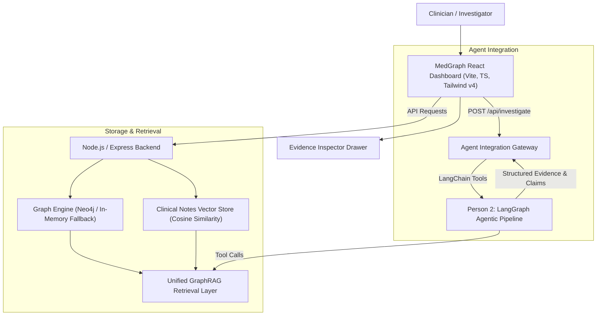

# MedGraph: Agentic Clinical Investigation Platform
> **Knowledge Graphs • Vector Retrieval • GraphRAG • Evidence Verification**

MedGraph is an agentic clinical investigation platform designed to investigate complex patient histories across multiple hospital admissions, clinical consultations, laboratory results, and doctor notes.

---

## Architecture Overview



---

## Key Features

1. **Longitudinal Synthetic Patient Cohorts (5 Patients)**:
   - `P001` - **Eleanor Vance**: HFrEF with progressive CKD; Lisinopril discontinued due to hyperkalemia (K+ 5.7) and acute renal decline; transitioned to Entresto (Sacubitril/Valsartan); Furosemide changed to Torsemide; documented cough contradiction; missing June 2025 echocardiogram report.
   - `P002` - **Marcus Thorne**: Recurrent DVT & PE on Warfarin; switched to Apixaban (Eliquis); diverticular lower GI bleed requiring dose reduction to 2.5mg BID; severe contradiction between lab INR (2.8) and physician note stating INR was 1.5.
   - `P003` - **Sarah Chen**: Relapsing-Remitting MS; Ocrelizumab withheld during severe E. coli urosepsis and septic shock; subsequent MS relapse treated with high-dose Solu-Medrol; contradictory entrance temperature (39.4°C triage vs 37.1°C note); missing blood culture sensitivity panel.
   - `P004` - **James Rodriguez**: COPD with Atrial Fibrillation; Amiodarone-Induced Thyrotoxicosis (TSH < 0.01) resulting in urgent Amiodarone cessation and switch to Metoprolol; missing discharge summary for ADM-401; contradictory smoking history.
   - `P005` - **Beatrice Kim**: Post-operative hip fracture repair; Oxycodone-induced delirium and visual hallucinations necessitating switch to Tramadol; OTC Benadryl anticholinergic toxidrome causing urinary retention; nursing delirium note directly contradicts resident note written 45 minutes later.

2. **Dual-Mode Graph Architecture**:
   - **Production Neo4j**: Connects via `neo4j-driver` with unique constraints and patient-scoped indexes.
   - **In-Memory Graph Engine**: High-fidelity in-memory graph store implementing the exact same Cypher-like traversals, allowing the application to run seamlessly offline or in Docker-less environments.

3. **Patient-Scoped Vector Retrieval**:
   - Configurable embeddings (`LocalSemanticEmbeddingProvider` or OpenAI `text-embedding-3-small`).
   - Mathematically verified cosine similarity search.
   - Strict patient-level filtering boundary preventing cross-patient data leakage.

4. **Multi-Admission Comparative Delta Service**:
   - Compares any two admissions for a patient.
   - Automatically computes medications added, medications discontinued, and dose modifications.
   - Computes significant biomarker shifts (e.g. Creatinine surges, Potassium spikes, INR swings).
   - Extracts documented clinical rationale with source record IDs.

5. **Evidence Provenance & Inspector**:
   - Every claim, timeline event, and graph node preserves its original `record_id` and timestamp.
   - One-click inspection displays the raw clinical document with provenance verification.

---

## Repository Structure

```text
MedGraph/
├── frontend/                     # React 19 + TypeScript + Tailwind CSS v4 + React Flow
│   ├── src/
│   │   ├── components/
│   │   │   ├── overview/         # Patient demographics, conditions, Recharts lab trends
│   │   │   ├── timeline/         # Interactive chronological clinical timeline
│   │   │   ├── graph/            # React Flow interactive knowledge graph explorer
│   │   │   ├── investigation/    # Question input and structured agent claim results
│   │   │   └── evidence/         # Evidence Inspector modal
│   │   ├── services/api.ts       # Typed API client
│   │   └── types/index.ts        # Shared domain types
│   └── package.json
│
├── backend/                      # Node.js + Express + TypeScript
│   ├── src/
│   │   ├── database/             # Neo4j driver, constraints, and indexes
│   │   ├── graph/                # Graph service and In-Memory Graph engine
│   │   ├── vector/               # Vector store, cosine similarity, and embeddings
│   │   ├── services/             # GraphRAG, timeline builder, and admission comparison
│   │   ├── controllers/          # Express route controllers
│   │   ├── routes/               # REST API route definitions
│   │   ├── schemas/              # Domain models and TypeScript interfaces
│   │   ├── ingestion/            # Synthetic clinical data generator and seeder
│   │   └── test/                 # Automated test suite (18 unit/integration tests)
│   └── package.json
│
├── agent/                        # Person 2 Integration resources
│   ├── README.md                 # Agent integration contract guide
│   ├── api_contract.json         # OpenAPI 3.1 schema specification
│   └── tools.py                  # Ready-to-use LangChain @tool definitions for Person 2
│
├── data/
│   └── synthetic-patients/       # Pre-generated JSON cohorts (5 patients, 210 nodes)
│
├── docker-compose.yml            # Docker orchestration for Neo4j Community + APOC
├── .env.example                  # Environment configuration template
└── README.md
```

---

## Getting Started

### Prerequisites
- Node.js v18+ (tested on v24)
- npm v9+

### 1. Install & Configure

```bash
# Clone the repository
git clone https://github.com/Sriram-Nambiar/MedGraph.git
cd MedGraph

# Backend setup
cd backend
npm install
cp .env.example .env

# Frontend setup
cd ../frontend
npm install
```

### 2. Run Tests

To verify graph ingestion, duplicate prevention, patient-scoped vector queries, and admission comparisons:

```bash
cd backend
npm test
```

### 3. Start Application

**Terminal 1 (Backend Server):**
```bash
cd backend
npm run dev
# Backend starts at http://localhost:5000
```

**Terminal 2 (Frontend Client):**
```bash
cd frontend
npm run dev
# Frontend starts at http://localhost:3000
```

---

## API Reference

| Method | Endpoint | Description |
|---|---|---|
| `GET` | `/api/health` | System status, Neo4j connectivity, and node/vector statistics |
| `GET` | `/api/patients` | List available synthetic patients |
| `GET` | `/api/patients/:patientId` | Demographics, active conditions, and medications |
| `GET` | `/api/patients/:patientId/timeline` | Chronological clinical timeline events |
| `GET` | `/api/patients/:patientId/admissions` | Sequential hospital admissions |
| `GET` | `/api/patients/:patientId/graph` | Subgraph nodes and relationships for React Flow |
| `POST` | `/api/graph/search` | Parameterized graph search by patient and query terms |
| `POST` | `/api/vector/search` | Cosine similarity semantic search across clinical notes |
| `POST` | `/api/graph/unified-search` | Unified GraphRAG retrieval (graph facts + note passages) |
| `POST` | `/api/admissions/compare` | Compares two admissions for medication & lab deltas |
| `POST` | `/api/investigate` | LangGraph agent integration endpoint |

---

## Optional: Starting Neo4j in Docker

If you wish to run a dedicated Neo4j instance:

```bash
docker-compose up -d
```
The backend automatically detects the live Neo4j instance at `bolt://localhost:7687` and syncs constraints and records. If Neo4j is not running, MedGraph automatically operates using its built-in in-memory graph engine with zero interruption!

---

## Hackathon Success Criteria Checklist

- [x] **Frontend**: Minimal professional dark-themed dashboard built with React, TypeScript, and Tailwind CSS.
- [x] **Knowledge Graph Visualization**: Interactive React Flow canvas with node inspection and type filtering.
- [x] **Clinical Timeline**: Chronological events linking admissions, consults, medication changes, and labs with direct provenance inspection.
- [x] **Lab Trends**: Recharts longitudinal biomarker trajectories.
- [x] **GraphRAG Retrieval Layer**: Structured Cypher-parameterized queries fused with vector clinical note retrieval.
- [x] **Vector Database**: Mathematically verified cosine similarity search with strict patient-level boundary enforcement.
- [x] **Agent Integration**: LangChain Python tool definitions and OpenAPI schema in `/agent` for Person 2.
- [x] **Synthetic Cohorts**: 5 authentic longitudinal patients with meaningful medication changes, lab trajectories, and documented contradictions.
