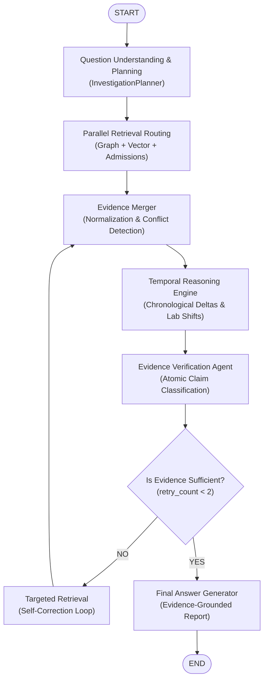

# MedGraph Agent Layer (LangChain + LangGraph)

This directory contains the complete **AI and agent orchestration layer** for MedGraph, built using LangChain and LangGraph.

It fulfills the **Person 2** role for the Hackathon, providing an evidence-grounded longitudinal clinical history investigation engine that connects with Person 1's Express/Neo4j backend.

---

## 1. Architecture



---

## 2. Features

- **Longitudinal History Investigation**: Compares patient hospital admissions, detects newly introduced medications, dose adjustments, and absent medications.
- **Evidence Verification (4 States)**: Decomposes findings into individual claims and classifies them as `SUPPORTED`, `CONTRADICTED`, `INSUFFICIENT`, or `NOT_FOUND`.
- **Causality Protection**: Refuses to assume causation from correlation. If a medication change has no documented rationale in physician notes, it is flagged as unverified and the system abstains.
- **Controlled Self-Correction**: Implements bounded retry loops (maximum 2 retries) for targeted retrieval when evidence is incomplete.
- **Thread & Patient Isolation**: Persists session state using LangGraph checkpointing (`MemorySaver`) while enforcing strict patient isolation.
- **Dual Mode**: Can run against Person 1's live backend (`USE_MOCK_API=False`, port 5000) or standalone with high-fidelity synthetic patient data (`USE_MOCK_API=True`).

---

## 3. Backend Integration (Person 1 <-> Person 2)

When the MedGraph Express backend calls `POST http://localhost:8000/investigate`:
1. The FastAPI service in `server.py` receives:
   ```json
   {
     "patient_id": "P001",
     "thread_id": "INV001",
     "question": "What changed between the last two admissions?"
   }
   ```
2. The LangGraph workflow executes end-to-end.
3. The service responds with the exact `InvestigationResponse` schema expected by the backend and frontend:
   ```json
   {
     "answer": "Medication changes identified: Furosemide (Dose adjusted from 20mg to 40mg), Entresto (Newly introduced)...",
     "patient_id": "P001",
     "thread_id": "INV001",
     "verification_status": "VERIFIED",
     "claims": [
       {
         "claim": "Medication Entresto (Sacubitril/Valsartan) was newly introduced in latest admission.",
         "status": "SUPPORTED",
         "evidence": [
           {
             "record_id": "MED-104",
             "timestamp": "2023-08-02T09:00:00Z",
             "quote": "Corroborated by medication records: ['MED-104']"
           }
         ],
         "explanation": "Directly supported by structured prescription records."
       }
     ],
     "key_findings": [...],
     "missing_information": [...],
     "contradictions_found": [...]
   }
   ```

---

## 4. Setup & Running the Agent Service

### 1. Install Dependencies
```bash
pip install -r requirements.txt
```

### 2. Configure Environment
```bash
cp .env.example .env
```
*(Defaults to mock mode, running out-of-the-box with zero setup)*

### 3. Start the FastAPI Service (Port 8000)
```bash
python server.py
# Or using uvicorn:
uvicorn app.server:app --port 8000 --reload
```

### 4. Run CLI Demo
```bash
python app/main.py "P001" "What changed between the patient's last two admissions? Were there any medication changes, and is the reason documented?"
```

### 5. Run Automated Tests
```bash
pytest -v
```
*(All 20 unit and clinical integration tests pass)*
